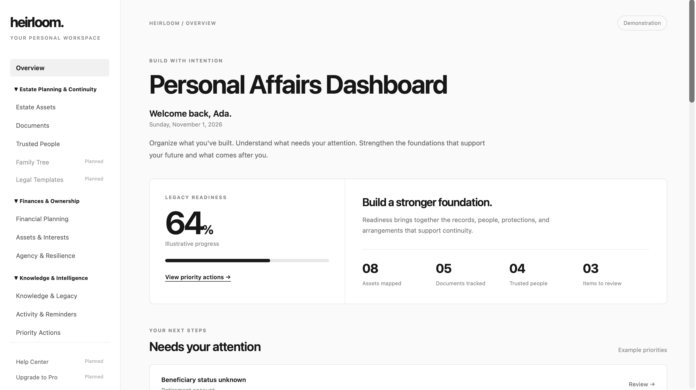

# Heirloom™

**Build with intention. Protect what matters. Carry it forward.**

People spend their lives building assets, businesses, intellectual property, relationships, and knowledge that deserve protection.

Heirloom™ is designed to make the infrastructure behind that legacy visible—what you own, what's exposed, who needs to know, and what must be in place for what you've built to endure.

Rather than treating legacy as synonymous with inheritance, Heirloom approaches it as an ongoing practice of ownership, stewardship, preparedness, and continuity.

## Live Demo

[Explore Heirloom™](https://heirloom-tyup.onrender.com)

The publicly hosted demonstration operates in read-only mode.

## Dashboard Preview



## Current Features

- **Personal Affairs Dashboard:** A responsive workspace featuring an illustrative Legacy Readiness overview, key indicators, and priority actions.
- **Asset Management:** A centralized register for financial, property, business, intellectual property, digital, creative, and other holdings.
- **Persistent Records:** Create, view, update, and delete asset records using MongoDB.
- **Ownership & Continuity Tracking:** Record asset categories, ownership status, beneficiary status, and continuity considerations.
- **REST API:** Express-based endpoints supporting asset creation, retrieval, updates, and deletion.
- **Read-Only Public Access:** A publicly accessible demonstration that restricts modifications to asset records.

## Technical Stack

- **Frontend:** HTML5, CSS3, JavaScript, EJS
- **Backend:** Node.js, Express
- **Database:** MongoDB Atlas, Mongoose
- **Deployment:** Render
- **Version Control:** Git, GitHub

## Running Locally

1. Clone the repository:

   ```bash
   git clone https://github.com/BuilderPlayground/heirloom.git
   ```

2. Navigate to the project directory:

   ```bash
   cd heirloom
   ```

3. Install dependencies:

   ```bash
   npm install
   ```

4. Create a `.env` file containing your MongoDB connection string:

   ```env
   MONGODB_URI=your_mongodb_connection_string
   ```

5. Start the application:

   ```bash
   node server.js
   ```

6. Visit `http://localhost:8082`.

To run the application in read-only mode:

```bash
DEMO_READ_ONLY=true node server.js
```

## Development Status

Heirloom™ is an evolving product, with this repository representing an intentionally scoped public implementation.

The current version establishes the foundational dashboard experience, database-backed asset management, and API functionality.

Some dashboard indicators, including the Legacy Readiness score and priority-action summaries, are illustrative rather than dynamically calculated.

The publicly hosted application uses fictional examples and does not provide authenticated personal data storage.

## Project Scope & Intellectual Property

This repository represents a limited public implementation and does not disclose the full scope of the underlying work, proprietary product strategy, or future development plans.

No open-source license has been granted for this repository.

## Disclaimer

Heirloom™ is not intended for storing sensitive personal, financial, or legal information in its current form.

Illustrative readiness indicators do not constitute legal, financial, or estate-planning advice.
